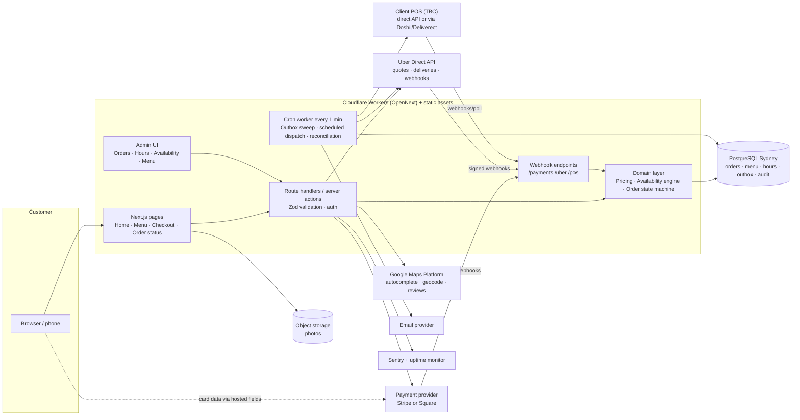

# F & G. Technology Comparison, Recommendation & System Architecture

Status: **Confirmed** (ADR-0001, 15 Oct 2026). **Hosting changed to Cloudflare Workers by ADR-0012 (20 Oct 2026)**: where this document still compares or mentions Vercel, read it as historical context. The current stack is in `design/PHASE-4-FOUNDATION.md` §2–3. Facts checked 14 Oct 2026 are marked `[Verified]`. Anything else is `[Assumption]` to re-check at setup.

## 1. Deciding requirements & constraints

- One shop, one time zone (Australia/Perth), AUD only, English. Small menu (~25 items). Low but peaky volume (lunch, evening, Fri/Sat late night). Expected peak volume `[Unknown]`, assumed < 2 orders/minute.
- Must integrate an **unknown POS**, **Uber Direct**, and **a payment provider still to be chosen**. The POS choice may decide the payment provider (§4).
- Reliability of money and order hand-off matters more than raw scale.
- Content must be fast and indexable: menu, hours and location for local search.
- Small budget and probably a small maintenance team. **Who maintains it after launch is unknown** (CLIENT_QUESTIONS Q12). That affects the stack choice.
- Future merchandise: an extra product type with shipping, not a marketplace.

## 2. Three coherent end-to-end options

### Option A — Full-stack TypeScript modular monolith (recommended)
**Next.js (App Router) on Vercel · PostgreSQL (Sydney) · Drizzle ORM · in-app staff auth · Stripe *or* Square payments · Postgres outbox + scheduled worker · Resend/Postmark email · Sentry.**
One codebase holds the website, checkout, admin, webhooks and integration adapters, with server-rendered pages for SEO and cached menu pages revalidated on menu change.

### Option B — Static site + separate API service
**Astro (static + islands) on a CDN · Node API (Hono/Fastify) on Fly.io/Render/Railway Sydney · PostgreSQL · pg-boss worker (long-running process).**
Better for long-running jobs with no serverless limits. Two deployables, more operations work (patching, scaling, health checks), and a second place to apply auth and validation.

### Option C — Buy the ordering, build the brand site
**POS-native online ordering** (e.g. Square Online if the POS is Square) **or Uber Eats Webshop**, plus a custom marketing site (Astro) linking out to it.
Fastest and cheapest to build. Menu, payments and POS sync come "for free". Less control over UX, branding and data, and checkout lives on a vendor domain. The Uber Eats Webshop costs **25% with Uber delivery / 6% pickup** `[Verified]`. Square Online's feature set in AU (e.g. delivery dispatch) `[Unknown]`.

### Comparison (weights reflect this project)

| Criterion (weight) | A: Next.js monolith | B: Astro + API | C: Buy + brand site |
|---|---|---|---|
| Requirement fit: hours/overrides/slots/custom flows (5) | ●●● full control | ●●● full control | ●○○ limited to vendor features |
| Distinctive UX (4) | ●●● | ●●● | ●○○ |
| Reliability of money/order flows (5) | ●●○ needs outbox + idempotency discipline | ●●● durable worker is easier | ●●● vendor-managed |
| Operational load (4) | ●●● managed platform | ●○○ servers/workers to run | ●●● |
| Build cost/time (4) | ●●○ | ●○○ | ●●● |
| Running cost (3) | ●●● low fixed | ●●○ | ●○○ (commission %) or ●●● (POS-native) |
| Integration flexibility, POS-agnostic (4) | ●●● adapters | ●●● | ●○○ |
| Lock-in / portability (3) | ●●○ Vercel-specific bits are small and replaceable | ●●● | ●○○ |
| Future merchandise (2) | ●●● | ●●● | ●●○ |

**Recommendation: Option A.** It is the simplest stack that still gives full control over availability logic, checkout UX and integrations. Everything runs on managed services, and the order hand-off can be made reliable with a transactional outbox (no extra infrastructure).
**Main trade-off:** serverless functions are short-lived, so background retries run as scheduled sweeps rather than an always-on worker. This is fine at this volume.
**What would change my mind:** (1) the POS has good native online ordering *and* the client values speed and low cost over a custom checkout → Option C for ordering, Option A-lite for content. (2) The maintainer is a PHP/WordPress shop → re-evaluate (e.g. WooCommerce plus plugins, with honest caveats about POS and Uber Direct plugin quality). (3) Complex long-running workflows appear → add a durable workflow service (Inngest/Trigger.dev) or move to Option B.
**Reversibility:** moderate. The domain logic lives in plain TypeScript modules and the database is standard Postgres, so moving to Node on Fly/Render later is a hosting change, not a rewrite.

## 3. Option A — component choices

| Layer | Choice | Why for this project | Alternatives considered |
|---|---|---|---|
| Frontend + rendering | **Next.js App Router, React, TypeScript.** Menu/Home/Visit server-rendered and cached, revalidated on admin change. Live status and cart are client islands. Checkout is dynamic. | SEO for local search, fast first paint, React ecosystem (shadcn-style primitives from 21st.dev), one language end to end. | Astro (great for content, weaker for app-like checkout/admin), Remix/React Router 7 (good, smaller hosting story), SvelteKit (smaller hiring pool) |
| Styling | Tailwind CSS + design tokens (CSS variables) | Fast and consistent. Matches the 21st.dev/shadcn component sources. | CSS Modules / vanilla-extract |
| UI primitives | Radix/Base UI-based components copied into the repo (shadcn approach) | Accessible dialogs, sheets, radio groups. No runtime dependency on a theme. | Headless UI, React Aria |
| Backend | Next.js Route Handlers + Server Actions calling a **domain layer** (`/src/domain`: pricing, availability, order state machine) | Single deployable. The domain layer is framework-free and unit-testable. | Separate API service (Option B) |
| API style | Internal: typed server actions / JSON route handlers with Zod validation. External: webhook endpoints per provider. | No public API needed yet. Avoids GraphQL/tRPC overhead. | tRPC, GraphQL |
| Database | **PostgreSQL**, managed, **Sydney region** (Neon or Supabase) | Relational integrity for orders/money, transactions, unique constraints for idempotency, `SELECT … FOR UPDATE SKIP LOCKED` for the outbox. | MySQL (fine), MongoDB/Firestore (weaker transactional guarantees for this domain), SQLite/Turso |
| Data access | **Drizzle ORM** + SQL migrations in git | Thin, SQL-transparent, serverless-friendly, typed. | Prisma, Kysely |
| Staff auth | **Better Auth** (self-hosted in our DB): email+password + TOTP MFA/passkeys, role-based access | No per-seat fees, data stays in our DB, MFA built in. Customers don't need accounts at MVP. | Clerk (SaaS, simplest MFA, lock-in + cost), Auth.js, Supabase Auth |
| Media | Item photos pre-resized at import (AVIF/WebP, several widths) and served as free Workers static assets through a custom `next/image` loader (ADR-0010) | 5000 px originals → optimised renditions automatically. | Cloudinary (excellent, extra cost) |
| Payments | **Depends on POS** (ADR-0004): Stripe Payment Element by default. Square Web Payments SDK if the POS is Square. | See §4 and INTEGRATIONS.md. | Tyro, Windcave, PayPal |
| Jobs & webhooks | **Transactional outbox** table. Work runs immediately after commit (`ctx.waitUntil()` behind an `afterCommit()` interface), and a **Cloudflare Cron Trigger (every minute)** sweeps retries with backoff and handles slot-based dispatch. All webhook handlers verify signatures and dedupe on event ID. | No extra vendor. Exactly-once *effects* through idempotency keys. | Inngest / Trigger.dev / Upstash QStash (add if workflows grow) |
| Email | Resend or Postmark (transactional only) | Simple API, good deliverability, AU-friendly. | SES (more setup) |
| SMS (Later) | Twilio or an AU provider (e.g. MessageMedia) | Order-ready texts are a nice-to-have. | — |
| Maps & address | Google Maps Platform: Places Autocomplete (New) + Geocoding (Uber needs lat/lng in some regions) + Places Details for rating/reviews | Address quality matters for delivery. Reviews are already on Google. | Geoscape/G-NAF (AU data, no reviews), Mapbox |
| Hosting/CDN | **Cloudflare Workers Paid (US$5/month) via the OpenNext adapter** (ADR-0012, 20 Oct 2026; was Vercel Pro). Static assets free at the edge | Lowest running cost. Every-minute Cron Triggers. 30 s CPU/request. Vercel Hobby is non-commercial `[Verified]`. | Netlify, Cloudflare Pages + Workers, Fly.io |
| DNS/domain | Cloudflare DNS (free) or the registrar's DNS. `.com.au` domain (requires an ABN, which the client has) | Fast DNS, easy records for email (SPF/DKIM/DMARC). | — |
| Observability | Sentry (errors + performance), Workers Logs, uptime monitor (Better Stack / UptimeRobot) hitting `/api/health` plus a synthetic "can I quote a delivery?" check | Know about failures before customers call. | Datadog (overkill) |
| Backups | Provider daily backups + weekly logical dump to separate storage. Optional PITR. | Orders/payments must be recoverable. Stripe/Square remain the money record. | — |
| Testing | Vitest (domain), Playwright (E2E, mobile viewports), axe-core, provider sandboxes | See TESTING.md | — |
| CI/CD | GitHub + GitHub Actions (lint, typecheck, test, migrations check) → Cloudflare preview → staging Worker on merge to `staging` → production Worker from `main` with manual promote | See DEPLOYMENT.md | — |

**Admin approach (sub-decision, ADR-0006):** build a **lean custom admin** inside the app for operational screens (orders, availability, hours, pause). These are the core of the product and need exact behaviour. Alternative: embed **Payload CMS 3** (open source, runs inside Next.js on Postgres) for content/menu editing, to cut admin build time at the cost of a heavier dependency and two data-modelling styles. Recommendation: custom admin, because the editable surface is small.

## 4. Payment provider (summary — full comparison in INTEGRATIONS.md §3)

| | Stripe (AU) | Square (AU) | Tyro | Windcave |
|---|---|---|---|---|
| Online card fee | **1.65% + A$0.30** domestic from 1 Oct 2026; intl 3.5% + 30c → 2.8% + 30c from 1 Apr 2027 `[Verified]` | **2.2%** flat online `[Verified]` | Quote-based, not published | Bundled. Card rate not published in extract; custom > A$50k/mo `[Verified]` |
| Wallets | Apple/Google Pay, Link | Apple/Google Pay | Yes `[Assumption]` | Apple Pay etc. |
| Dev experience | Excellent APIs, webhooks, test mode | Good. Orders + Payments tightly linked to Square POS | Limited public docs | Dev account via sales |
| POS fit | Any POS (record the payment as external in the POS) | **Native** if the POS is Square (paid orders appear in POS/Order Manager) | Natural if the client already uses Tyro EFTPOS | Neutral |

Fee break-even between Stripe and Square online: Square is cheaper below ~**A$55** order value (0.30 ÷ (2.2% − 1.65%)). Typical Chai Tapri baskets are probably A$10–35, which favours Square's flat rate *if* the POS is Square anyway. **Recommendation:** POS = Square → Square payments. Any other POS → Stripe. Decide after Q1 is answered.

## 5. System architecture

**How the parts relate**
- **The browser never sends prices or totals that the server trusts.** It sends item IDs, modifier IDs, quantities, fulfilment and slot. The server prices everything from the database.
- **Card data never touches our servers.** The payment provider's hosted fields/Element collect it (PCI SAQ-A).
- **Payment provider** = system of record for money. **Uber Direct** = system of record for courier status. **POS** = system of record for whatever it owns (see INTEGRATIONS.md §1). **Our DB** = system of record for online orders, hours, overrides and web content.
- **External calls with side effects** (submit to POS, create delivery, send email) go through the **outbox**: written in the same DB transaction as the state change, executed after commit, retried with backoff, and idempotent by key (`order_id:action`).
- **Merchandise later:** add a `product_type` (food | merch) and a `shipping` fulfilment type. Reuse cart/checkout/payment. Food-only rules (slots, prep time) apply only to food. No generic commerce engine now.

## 6. Indicative running costs (monthly, AUD, excluding transaction fees)

| Item | Estimate | Basis |
|---|---|---|
| Cloudflare Workers Paid (was Vercel Pro) | ~A$8 | US$5/mo `[Verified 20 Oct 2026]`. See PHASE-4-FOUNDATION §2 for the full low-cost breakdown |
| Postgres (Neon/Supabase paid tier) | ~A$30–45 | Supabase Pro from US$25 `[Verified]`. Neon similar `[Assumption]` |
| Object storage | ~A$0–5 | Small image set |
| Email | A$0–30 | Free tiers cover low volume `[Assumption]` |
| Sentry / uptime | A$0–40 | Free tiers likely enough at launch |
| Google Maps Platform | A$0–30 | Usage-based with monthly free usage per SKU `[Assumption — verify current pricing]` |
| Domain (.com.au) | ~A$2–4 (A$25–45/yr) | — |
| POS integration / middleware | **A$0–150+** | Depends entirely on the POS (direct API often free; Doshii/Deliverect are subscriptions) `[Unknown]` |
| **Total fixed** | **≈ A$70–300 / month** | |

Per-order variable costs: payment fee (e.g. A$25 order → Stripe A$0.71 / Square A$0.55) + Uber Direct fee for delivery orders (**A$10 + A$1.10/km ex GST**, e.g. 3 km ≈ A$13.30 ex GST / A$14.63 inc GST) `[Verified]`.
