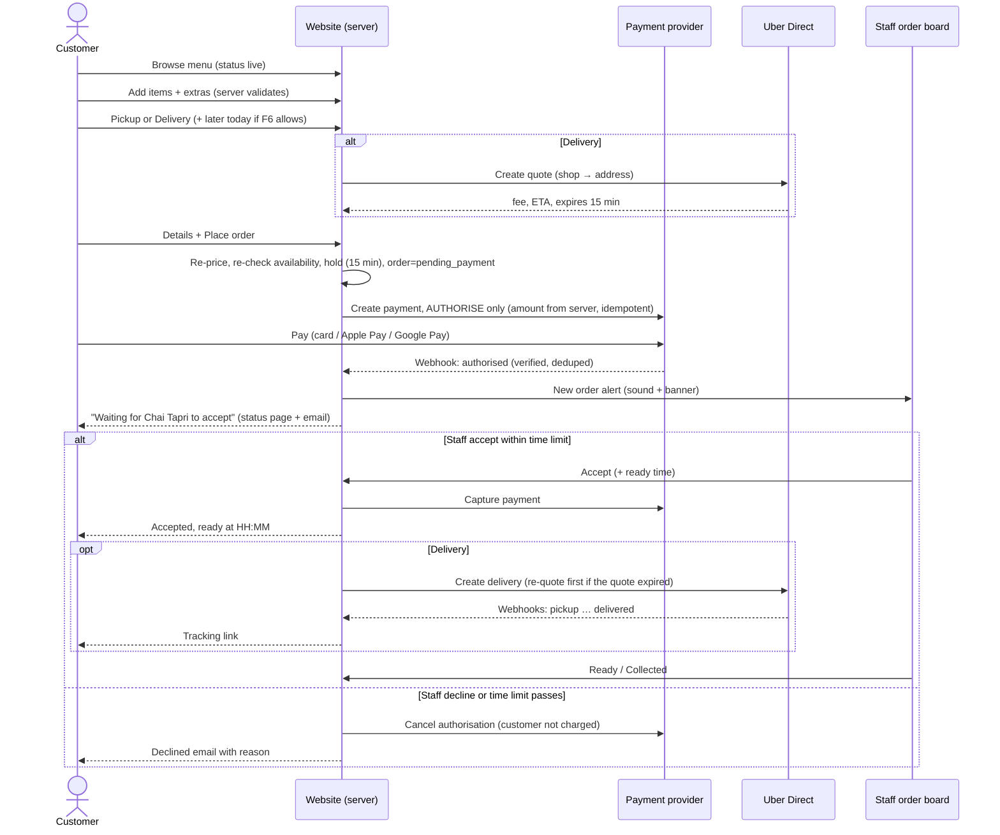

# I. Operational Workflows & Business Rules

All rules are **Proposed** unless marked Confirmed. Values in `{braces}` are placeholders the client must set. Never ship a placeholder as fact.

## 1. Availability engine (shop hours, ordering, overrides)

### 1.1 Concepts
- **Shop hours** = when the doors are open (shown on the site and Google).
- **Ordering windows** = when online orders can be *fulfilled*. They usually start later or end earlier than shop hours (e.g. last online order 20 min before close).
- **Delivery windows** = a subset of ordering windows where Uber Direct delivery is offered (e.g. not after 11pm if couriers are scarce — test).
- **Date exceptions** = closures or special hours on a specific local date (public holidays, Diwali, events, staff shortage planned ahead).
- **Manual override** = the owner opens or closes online ordering by hand: **"Close now"** (with an optional end time) or **"Open now until HH:MM"** (an end time is required). **Confirmed 15 Oct 2026:** the owner must be able to open and close orders manually, and to keep ordering open past the nightly cut-off.

### 1.2 Precedence (highest wins)
1. **Kill switch** (owner only): online ordering disabled entirely (e.g. website problem).
2. **Active manual override** (Close now / Open now until HH:MM; scope: all or delivery only). The most recent override wins. Each ends at its end time, or for "Close now" with no end time, when someone reopens it.
3. **Date exception** for the trading day (holiday closure, special hours planned ahead).
4. **Weekly schedule** (automatic open at opening time, automatic stop at the nightly cut-off). **Confirmed 15 Oct 2026:** ordering stops automatically each night unless the owner keeps it open.

"Open now" works even outside scheduled hours (e.g. on a Tuesday), because the owner asked for full open/close control. It always needs an end time so it can't be left on by accident (F10, recommended).
Who can override: owner by default. The owner can grant it to managers `[Assumption]`. Staff can only **Close now** (e.g. kitchen overloaded), not open.

### 1.3 Rules
- **BR-AV-1** Time zone is `Australia/Perth` (UTC+8, no daylight saving). All calculations use a tz-aware library. Never hard-code +8.
- **BR-AV-2** Windows can cross midnight (Fri/Sat 11:00 → 01:00). A slot at 00:30 Saturday belongs to **Friday's** trading day for exceptions and capacity. (Example: a "Closed Friday" exception also closes 00:00–01:00 Saturday.)
- **BR-AV-3** ASAP is offered only if `now + prep_time ≤ ordering_window_close − {last_order_offset}` and no pause applies. For delivery, also `now + prep + courier pickup ETA` must fit the delivery window.
- **BR-AV-4** **Same-day only (Confirmed 15 Oct 2026):** customers can't order for another day. Whether they can pick a **later time today** or only ASAP is still open (F6). If later-today is allowed: `{15}`-minute slots from `now + prep_time` to the cut-off, inside ordering (and delivery) windows, excluding full slots.
- **BR-AV-5** Capacity: `{max_orders_per_slot}` and/or `{max_items_per_slot}`. Manual acceptance (BR-ORD-2) is also a natural brake: staff can decline when overloaded.
- **BR-AV-6** "Close now" (15/30/60 min, until the cut-off, or until reopened) blocks new orders immediately. Orders already waiting for acceptance stay on the order board for staff to accept or decline. The dialog shows how many are waiting.
- **BR-AV-7** A "Close now" with no end time reminds the owner after `{60}` min and shows a banner on the order board, so an accidental all-day closure gets noticed. "Open now until HH:MM" ends exactly at its time. 15 min before, the order board warns "Online ordering closes at HH:MM" with a one-tap extend.
- **BR-AV-8** Server re-validates availability at **three points**: (1) adding to cart (advisory), (2) placing the order (authoritative, holds the slot for 15 min), (3) payment confirmation (honour the hold, see BR-AV-9).
- **BR-AV-9** If the payment authorisation succeeds while the hold is valid, the order goes to the order board even if ordering closed in the meantime. Staff decide to accept or decline. A decline releases the authorisation, so the customer is never charged. If the hold expired → the authorisation is released + an email is sent.
- **BR-AV-10** Changing today's hours or closing while orders are waiting or in progress shows a warning listing them. (Future-day conflicts can't happen because orders are same-day only.)
- **BR-AV-11** Future changes: date exceptions and setting changes take an **effective-from** date, so staff can schedule "New winter hours from 1 June" in advance.
- **BR-AV-12** The customer-facing status (header chip, menu banner, checkout) is computed by the same function as ordering. "Open now" can never disagree with "can order now". Menu pages are cached, but the status chip is fetched live (short TTL).
- **BR-AV-13** WA public holidays are pre-loaded yearly as *suggested* exceptions that staff confirm (opening on a public holiday is the client's choice).
- **BR-AV-14** Item availability: sold-out toggles apply immediately (`until end of day` default). If a cart contains an item that became unavailable, checkout blocks with a clear message and a "remove item" action.

### 1.4 Edge-case table (test cases)
| Case | Expected |
|---|---|
| Fri 23:50, prep 10 min, online cut-off 00:30 (30 min before the 01:00 close) | ASAP allowed (ready 00:00 ≤ 00:30) |
| Fri 00:25 (Sat calendar), same window | ASAP denied (00:35 > 00:30). Status "Online ordering closed · opens Sat 11:00" |
| Fri 00:40 (Sat calendar) | Closed (past the cut-off). Next: "Opens Sat 11:00" |
| Tuesday (closed) | Status "Closed · opens Wed 11:00". No ordering ahead for Wednesday (same-day only) |
| Owner taps "Open now until 16:00" on Tuesday | Ordering open until 16:00, then closed automatically |
| Thu 21:40, owner taps "Keep open until 23:00" past the 21:30 cut-off | Orders accepted until 23:00. Board warns at 22:45 |
| "Close now, until reopened" at 20:00 Thu | Closed, with a reminder after 60 min. Proposed: a manual close expires at the end of the trading day, so Friday opens automatically at 11:00 `[Assumption — confirm with owner, CLIENT_QUESTIONS F12]` (implemented 24 Oct 2026) |
| Customer on payment page when staff close ordering | Authorisation completes within the hold → order on the board. Staff accept or decline |
| Order not accepted within `{5}` min | Auto-declined, authorisation released, customer emailed |
| Uber quotes failing for 5 min | Delivery auto-hidden ("Delivery unavailable right now"). Pickup still works. Staff alerted |

## 2. Customer ordering workflow

Reflects the 15 Oct 2026 answers: same-day only, **staff accept each order**, customer pays delivery, POS not yet chosen (the order board is the kitchen's source of truth).

## 3. Order lifecycle (state machine)

`pending_payment → awaiting_acceptance → accepted → preparing → ready → completed`
Branches: `pending_payment → expired` · `awaiting_acceptance → declined | timed_out | cancelled_by_customer` (authorisation released, no charge) · `accepted|preparing → cancelled` (refund per policy) · delivery: `ready → out_for_delivery → completed | delivery_failed`.

- **BR-ORD-1** Transitions are server-enforced and only move forward. Each is recorded in `order_event` with its actor.
- **BR-ORD-2** **Staff accept each order (Confirmed 15 Oct 2026).** On accepting, staff confirm or adjust the ready time (default = now + prep time). Declining requires a reason (too busy / item unavailable / closing / other), which is shown to the customer.
- **BR-ORD-2a** Acceptance time limit `{5}` min (F7). After `{3}` min an unaccepted order escalates: a louder alert, plus a notification to the owner's phone. At the limit it is auto-declined, the authorisation is released and the customer is emailed.
- **BR-ORD-3** Payment, delivery and (later) POS statuses are tracked separately and shown together on the order board.
- **BR-ORD-4** Customer cancellation: allowed online while `awaiting_acceptance` (authorisation released). After acceptance, they contact the shop. Staff can cancel any time with a reason and refund per the policy below.
- **BR-ORD-5** Refund policy (to be confirmed by the client + adviser and consistent with the ACL): full refund if the shop cancels after accepting, an item is unavailable (or partial for that item), or delivery fails for reasons not caused by the customer. Food that is wrong, unsafe or not as described → remedy under the consumer guarantees. Change of mind after preparation → no refund (allowed under the ACL, but must be stated clearly).
- **BR-ORD-6** Pickup orders not collected within `{60}` min after ready → staff mark `completed (not collected)`. No automatic refund.
- **BR-ORD-7** Order numbers are short and human-readable. The public status link uses the random token, never the order number or the DB id.
- **BR-ORD-8** Duplicate prevention: one order per checkout attempt. The Pay button is disabled while in flight. The confirmation page is reached by polling server status.
- **BR-ORD-9** **Until a POS is chosen (Q1 open), the order board is the kitchen's source of truth:** audible alert, Accept/Decline, Ready, Collected, and a printed docket if a printer is configured. Staff ring the order into the till separately for their sales records (double entry). That is a known trade-off until the POS adapter exists.

## 4. Pricing rules
- **BR-PR-1** Menu prices are GST-inclusive AUD, **equal to the in-store menu board** (Confirmed 15 Oct 2026, see MENU.md). The cart shows the total and "includes GST $x".
- **BR-PR-2** The server computes all totals from DB prices at order time. The client never supplies prices.
- **BR-PR-3** **The customer pays the delivery fee (Confirmed 15 Oct 2026).** Proposed method `[Assumption, F1]`: the Uber Direct quote is passed through as quoted, including GST, as a separate "Delivery" line shown before payment. The accountant should confirm the GST treatment of on-charged delivery.
- **BR-PR-4** No card surcharges (RBA). Any service fee (if introduced) must be displayed upfront with prices. Drip-pricing rules apply from 1 Jul 2027 (COMPLIANCE.md).
- **BR-PR-5** Combos are priced as listed (fixed bundle price), with choices per MENU.md open questions.
- **BR-PR-6** Minimum order for delivery `{$X}`. Max distance `{Y km}` (Uber's general limit ~15 km) (F2).

## 5. Payment rules
- **BR-PAY-1** An order's payment state changes only on a verified provider webhook or API response.
- **BR-PAY-2** **Authorise at checkout, capture on staff acceptance** (changed from "immediate capture" because staff accept each order). A declined or timed-out order is never charged, so there are no refund fees and no "refund in 5–10 days" complaints. Capture happens within minutes, well inside authorisation validity (Stripe online card holds: 7 days `[Verified — Stripe docs, 15 Oct 2026]`; Square delayed capture `[Assumption — verify if Square is chosen]`).
- **BR-PAY-3** Refunds (after capture) only by manager/owner, reason required, audited. Partial refunds by line or amount, never above the captured amount.
- **BR-PAY-4** Daily reconciliation: provider payments ↔ orders (mismatch → alert). Weekly: Uber Direct fees billed ↔ delivery fees collected.

## 6. Delivery rules
- **BR-DEL-1** Delivery is offered only if: delivery enabled, inside the delivery window, address geocoded, a valid quote received, distance ≤ max, basket ≥ minimum.
- **BR-DEL-2** The Uber delivery is created **at acceptance**, with pickup ready time = the ready time staff confirm. Uber quotes expire after 15 min. If the quote expired by acceptance, the server re-quotes: if the new fee is ≤ the fee the customer authorised, proceed (any difference is kept or refunded, per F1); if higher, the shop absorbs up to `{$2}` automatically, and above that staff choose to absorb, convert to pickup (call the customer), or decline. Keeping the acceptance time limit short (BR-ORD-2a) makes this rare.
- **BR-DEL-3** Delivery failures follow INTEGRATIONS.md §4.4.6. A customer refund for a failed delivery is decided by staff using preset reasons.
- **BR-DEL-4** Customer phone number is shared with Uber for the courier. The privacy policy must disclose this.
- **BR-DEL-5** Uber Direct account: the client already uses Uber Direct (Confirmed 15 Oct 2026). API access to be confirmed (F3).

## 7. Staff workflows (daily)
1. **Opening:** the order board shows "Online ordering opens at 11:00 automatically". Check sold-out items and integration health (green/amber/red).
2. **During service:** new-order alert → **Accept (confirm ready time) or Decline (reason)**. Mark Ready, then Collected (or the delivery is tracked automatically). "Close online orders" is always visible at the top.
3. **Problems:** item runs out → toggle sold out (until tomorrow). Rush → Close now for 30 min, or decline with "too busy". Uber failing → turn off delivery.
4. **Closing:** ordering stops automatically at the cut-off. The owner can tap "Keep open until HH:MM". Review not-collected orders.
5. **Owner controls:** Open now / Close now at any time (with end time), weekly hours, holiday closures and special hours ahead, site notices.
6. **Weekly:** reconciliation report, review failed jobs/alerts.
