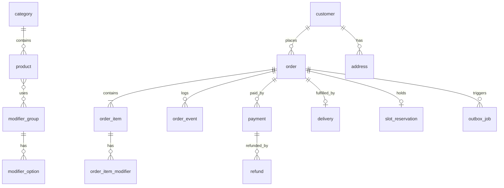

# H (part 1). Preliminary Data Model & Consistency Strategy

Status: §1–5 = preliminary model for all slices. **§6 = slice-1 schema, Confirmed by the project lead, 19 Oct 2026**, and it supersedes §1 where they differ. PostgreSQL (ADR-0002). Money in **integer cents, AUD, GST-inclusive**. Timestamps `timestamptz` (UTC), with local date/time rules evaluated in `Australia/Perth`.

## 1. Entities

### Catalogue
| Entity | Key fields | Notes |
|---|---|---|
| `category` | id, slug, name, sort, is_visible | |
| `product` | id, category_id, slug, name, description, base_price_cents, product_type (`food`\|`merch` later), is_web_visible, is_available, available_until (sold out "until tomorrow"), dietary_tags[], allergens[] (FSANZ list), image_key, image_alt, pos_ref, sort | One chai product with size/flavour modifiers instead of 4 near-duplicates |
| `modifier_group` | id, name, min_select, max_select, sort, pos_ref | e.g. Size (1..1), Add-ons (0..3) |
| `modifier_option` | id, group_id, name, price_delta_cents, is_available, is_default, pos_ref | |
| `product_modifier_group` | product_id, group_id, sort | Many-to-many |
| `menu_sync_run` | id, source(pos), started_at, finished_at, status, changes_json, error | Only if the POS is the menu master |

### Operating schedule
| Entity | Key fields | Notes |
|---|---|---|
| `weekly_hours` | id, weekday (1–7), opens_at (local time), closes_at (local time), closes_next_day (bool), kind (`shop`\|`ordering`\|`delivery`) | Fri/Sat 11:00 → 01:00 = closes_next_day. Several rows per day allowed (split shifts) |
| `date_exception` | id, local_date, kind (`closed`\|`special_hours`), opens_at, closes_at, closes_next_day, applies_to (shop/ordering/delivery), reason, public_note | Public holidays, events, special hours. Can be created far ahead (scheduled change) |
| `ordering_override` | id, scope (`all`\|`delivery`), mode (`open`\|`closed`), starts_at, ends_at (required for `open`; nullable for `closed` = until reopened), reason, created_by, cleared_at, cleared_by | Owner's manual Open now / Close now (15 Oct 2026). The latest active row wins. History kept for audit |
| `fulfilment_settings` | singleton: prep_minutes_default, slot_minutes (e.g. 15), max_orders_per_slot, max_items_per_slot, schedule_ahead_days, last_order_offset_minutes, delivery_enabled, delivery_min_order_cents, delivery_max_km, delivery_fee_policy, delivery_fee_cap_cents | Versioned by updated_at + audit |
| `slot_reservation` | id, slot_start, order_id (unique), item_count, expires_at, status (`held`\|`confirmed`\|`released`) | Capacity enforcement (see §3) |

### Customers & orders
| Entity | Key fields | Notes |
|---|---|---|
| `customer` | id, name, email, phone_e164, marketing_opt_in, opt_in_at, opt_in_source, created_at, anonymised_at | Guest orders still create/link a customer row by email. No passwords at MVP |
| `address` | id, customer_id, line1, line2, suburb, state, postcode, lat, lng, instructions, place_id | Delivery only |
| `order` | id (uuid), number (human, e.g. `A1234`, unique per day sequence), public_token (random 128-bit), customer_id, fulfilment (`pickup`\|`delivery`), timing (`asap`\|`scheduled`), requested_slot_start (same day only), promised_ready_at, accept_deadline_at, accepted_at, accepted_by, decline_reason, status (incl. `awaiting_acceptance`, `declined`, `timed_out`), payment_status (`authorised`\|`captured`\|`voided`\|`refunded`…), pos_status, delivery_status, subtotal_cents, delivery_fee_cents, discount_cents, total_cents, gst_cents, notes, pricing_version, created_at, placed_at, cancelled_at, cancel_reason | **Status fields are separate**: order lifecycle vs payment vs POS vs delivery |
| `order_item` | id, order_id, product_id, name_snapshot, unit_price_cents_snapshot, quantity, line_total_cents, allergens_snapshot | **Snapshots**: later menu edits never change past orders |
| `order_item_modifier` | id, order_item_id, option_id, name_snapshot, price_delta_cents_snapshot | |
| `order_event` | id, order_id, type, from_status, to_status, actor (system/staff id/provider), payload_json, created_at | Append-only timeline/audit |

### Money & delivery
| Entity | Key fields | Notes |
|---|---|---|
| `payment` | id, order_id, provider (`stripe`\|`square`), provider_payment_id (unique), amount_cents, status, method_brand, last4, created_at | No card numbers stored. last4 only for support |
| `refund` | id, payment_id, provider_refund_id (unique), amount_cents, reason, status, requested_by, created_at | |
| `delivery_quote` | id, order_id/cart_id, provider_quote_id, fee_cents, pickup_eta, dropoff_eta, expires_at, request_hash | Re-quote when expired |
| `delivery` | id, order_id (unique while active), provider_delivery_id (unique), external_id, status, tracking_url, courier_name, fee_cents, undeliverable_reason, return_delivery_id, created_at | Mirrors Uber |

### Integration plumbing
| Entity | Key fields | Notes |
|---|---|---|
| `outbox_job` | id, kind (`pos.submit`, `delivery.create`, `email.confirmation`…), dedupe_key (unique), payload_json, status (`pending`\|`running`\|`done`\|`failed`\|`dead`), attempts, next_run_at, last_error, locked_until | Executed after commit. Workers claim jobs with `FOR UPDATE SKIP LOCKED` |
| `webhook_event` | id, provider, provider_event_id, **unique(provider, provider_event_id)**, signature_valid, received_at, processed_at, status, payload_json (PII-minimised), error | Dedupe + replay |
| `integration_ref` | entity, entity_id, provider, external_id, unique(provider, external_id) | Generic ID mapping (POS item IDs etc.) |
| `integration_health` | provider, last_success_at, last_failure_at, consecutive_failures, status | Drives the admin panel and alerts |

### Staff & content
| Entity | Key fields | Notes |
|---|---|---|
| `staff_user`, `session`, `mfa_factor` | (auth library tables) | MFA required for manager/owner |
| `staff_user.role` | `staff`, `manager`, `owner` (null = access removed) | Permissions as code-defined capabilities per role (simpler than a permission table at this size) |
| `audit_log` | id, actor_id, action, entity, entity_id, before_json, after_json, ip_hash, created_at | Hours/price/refund/override/staff changes |
| `site_notice` | id, message, severity, starts_at, ends_at, placement | "Closed for Diwali" banners |
| `page_content` | key, fields_json, updated_by | About text, FAQs. A small, structured content model, not a CMS |



## 2. Transaction boundaries

| Step | In one DB transaction | Outside (after commit, via outbox/idempotent call) |
|---|---|---|
| Place order | Validate cart against the menu + availability → insert order + items (snapshots) → hold slot (`slot_reservation` held, expires in 15 min) → status `pending_payment` | Create PaymentIntent (idempotency key = order id), get the delivery quote if not fresh |
| Payment webhook (authorised) | Insert `webhook_event` (unique) → payment `authorised` → order `awaiting_acceptance` (guarded transition), set `accept_deadline_at` → enqueue `staff.alert`, `email.received` | Execute outbox jobs |
| Staff accept | Guarded transition `awaiting_acceptance → accepted` (only one staff member can win) + ready time + audit → enqueue `payment.capture`, `delivery.create` (delivery orders), `email.accepted` (+ `pos.submit` once a POS exists) | Capture (idempotency key = order id), then delivery |
| Staff decline / deadline passes (cron sweep) | Guarded transition → `declined`/`timed_out` + reason → enqueue `payment.void`, `email.declined` | Cancel the authorisation |
| Staff status change | Guarded transition (`UPDATE … WHERE status = :expected`) + order_event + audit | Customer email/SMS (outbox) |
| Refund | Insert refund `requested` + audit | Provider refund API (idempotency key = refund id). Webhook finalises |

## 3. Consistency & failure handling

- **Duplicate orders:** the client generates a `checkout_attempt_id`, and the server enforces unique (order per attempt). The "Pay" button disables while in flight. The payment idempotency key derives from the order ID.
- **Duplicate webhooks / out-of-order delivery:** dedupe on `(provider, event_id)`. State transitions use a **monotonic state machine** (ignore events that would move backwards, e.g. `pickup` arriving after `delivered`). Store the event regardless for audit.
- **Payment succeeded but our DB write failed:** the provider retries the webhook. A reconciliation job every 10 min lists recent provider payments with `order_id` metadata and repairs missing ones.
- **Order created but payment never completes:** the slot hold expires (15 min) → order `expired`. The PaymentIntent is cancelled by the sweep.
- **Paid but shop now closed/paused (race):** if payment succeeded within the hold window, the order is honoured (BR-AV-9). Otherwise auto-refund + notify.
- **POS/Uber failures:** outbox retries with exponential backoff + jitter. After a threshold → `dead` + staff alert. All external create calls carry our order ID so retries are detectable.
- **Concurrency on slot capacity:** `SELECT … FOR UPDATE` on a per-slot counter row, or rely on a unique-index-based count, so two checkouts can't both take the last place.
- **Money arithmetic:** integers only. GST = round(total × 1/11) for display on the tax invoice (all items assumed taxable food/drink — **confirm GST treatment with the accountant**, as some basic foods are GST-free).
- **Historical integrity:** order items never reference live prices for display. Snapshots are used.

## 4. Privacy & retention
- Collect only what's needed: name, phone, email, delivery address (delivery only).
- Don't log full payloads containing PII. Redact phone/email/address in logs and Sentry.
- Retention proposal (needs client and adviser approval): personal fields anonymised **24 months** after the last order. Financial records (amounts, GST, dates, order numbers) kept **5 years** (ATO record-keeping). Webhook payloads purged after 90 days.
- Non-production databases use synthetic seed data only. Never copy production.

## 5. Future merchandise
Add `product_type='merch'`, `variant` (size/colour, SKU, stock), `fulfilment='shipping'`, and a `shipment` table. Cart, checkout, payment, refunds and order tables are reused. Slot/prep rules are scoped to `food`. Nothing is built now beyond the `product_type` column.

## 6. Slice-1 schema (pickup ordering) — Confirmed 19 Oct 2026

**Conventions:** tables plural `snake_case` (avoids the reserved word `order`). PK `id uuid` (v7, time-ordered) except lookups. Every table has `created_at`/`updated_at timestamptz not null default now()` (omitted below for brevity). Money `*_cents integer` with non-negative checks. Enum-like columns are `text` + `check (col in (…))`, which is easier to migrate than Postgres enums. FKs `on delete restrict` unless stated. Catalogue rows are never hard-deleted: set `archived_at` instead. Drizzle migrations in git, one tool for every environment.

**Simplification (approved by the project lead, 24 Oct 2026):** three tables merged into others to keep the schema small. `staff_roles` → `staff_users.role` (migration 0005, built); `order_item_options` → `order_items.options` (jsonb receipt snapshot); `media_assets` → `products.image_key` + `image_alt` (photo usage rights are recorded once in docs, CLIENT_QUESTIONS F9). **Kept separate on purpose:** `customers` and `payments`. Slice 1 = **26 tables**: 20 below + 6 auth-library tables. Built so far: 12 (store_settings, cron_heartbeats, weekly_hours, date_exceptions, ordering_overrides, audit_log + the 6 auth tables).

```sql
-- Catalogue -----------------------------------------------------------------
create table categories (
  id uuid primary key, slug text not null unique, name text not null,
  sort int not null default 0, is_visible boolean not null default true, archived_at timestamptz);

create table products (
  id uuid primary key, category_id uuid not null references categories(id),
  slug text not null unique, name text not null, short_description text, description text,
  base_price_cents int not null check (base_price_cents >= 0),
  product_type text not null default 'food' check (product_type in ('food','merch')),
  is_combo boolean not null default false,
  is_web_visible boolean not null default true,
  sold_out_until timestamptz,                     -- null = available; "sold out today" = next 05:00 local
  dietary_tags text[] not null default '{}',
  allergens text[] not null default '{}',         -- FSANZ list; empty until Q10 answered
  image_key text,                                -- photo slug: public/menu/<image_key>-<width>.avif|webp (pnpm images)
  image_alt text,                                 -- alt text; required when image_key is set
  sort int not null default 0, archived_at timestamptz,
  check (image_key is null or image_alt is not null));
create index products_category_sort on products (category_id, sort) where archived_at is null;

create table option_groups (
  id uuid primary key, name text not null,       -- Size, Style, Extras, Chai, Drink
  min_select int not null check (min_select >= 0),
  max_select int not null check (max_select >= 1),
  check (min_select <= max_select));

create table options (
  id uuid primary key, group_id uuid not null references option_groups(id),
  name text not null, price_delta_cents int not null default 0 check (price_delta_cents >= 0),
  max_qty int not null default 1 check (max_qty between 1 and 5),  -- e.g. extra cheese x2
  is_default boolean not null default false, sold_out_until timestamptz,
  sort int not null default 0, archived_at timestamptz);

create table product_option_groups (
  product_id uuid not null references products(id), group_id uuid not null references option_groups(id),
  sort int not null default 0, primary key (product_id, group_id));

-- Operating schedule ----------------------------------------------------------
create table store_settings (                    -- singleton row (id = 1)
  id smallint primary key check (id = 1),
  timezone text not null default 'Australia/Perth',
  trading_day_boundary time not null default '05:00',
  prep_minutes_default int not null default 10 check (prep_minutes_default between 1 and 120),
  last_order_offset_minutes int not null default 30 check (last_order_offset_minutes between 0 and 180),
  accept_timeout_seconds int not null default 300 check (accept_timeout_seconds between 60 and 1800),
  accept_escalate_seconds int not null default 180,
  checkout_hold_minutes int not null default 15,
  max_order_total_cents int not null default 50000,
  online_ordering_enabled boolean not null default true,   -- owner kill switch
  updated_by uuid);

create table weekly_hours (
  id uuid primary key, weekday smallint not null check (weekday between 1 and 7),  -- ISO, 1 = Monday
  opens_at time not null, closes_at time not null, closes_next_day boolean not null default false,
  check (closes_next_day or opens_at < closes_at));
create index weekly_hours_weekday on weekly_hours (weekday);

create table date_exceptions (
  id uuid primary key, trading_date date not null,
  kind text not null check (kind in ('closed','special_hours')),
  opens_at time, closes_at time, closes_next_day boolean not null default false,
  reason text not null, public_note text, created_by uuid not null,
  check ((kind = 'closed' and opens_at is null and closes_at is null)
      or (kind = 'special_hours' and opens_at is not null and closes_at is not null)));
create index date_exceptions_date on date_exceptions (trading_date);

create table ordering_overrides (
  id uuid primary key, mode text not null check (mode in ('open','closed')),
  scope text not null default 'all' check (scope in ('all','delivery')),
  starts_at timestamptz not null default now(), ends_at timestamptz,
  reason text, created_by uuid not null, cleared_at timestamptz, cleared_by uuid,
  check (mode = 'closed' or ends_at is not null),          -- "Open now" always needs an end time (F10)
  check (ends_at is null or ends_at > starts_at));
create index ordering_overrides_active on ordering_overrides (starts_at desc) where cleared_at is null;

-- Customers & orders ------------------------------------------------------------
create table customers (
  id uuid primary key, name text not null check (length(name) between 1 and 80),
  email text not null, phone_e164 text not null check (phone_e164 ~ '^\+61[0-9]{9}$'),
  marketing_opt_in boolean not null default false, opt_in_at timestamptz, opt_in_source text,
  anonymised_at timestamptz);
create unique index customers_email on customers (lower(email)) where anonymised_at is null;

create table daily_counters (trading_date date primary key, last_number int not null);

create table orders (
  id uuid primary key,
  public_token text not null unique,                       -- 128-bit random, base64url
  trading_date date not null, order_number int not null,   -- shown as "#047"
  checkout_attempt_id uuid not null unique,                -- client idempotency key
  request_fingerprint text not null,                       -- hash of the normalised request
  customer_id uuid not null references customers(id),
  fulfilment text not null default 'pickup' check (fulfilment in ('pickup','delivery')),
  timing text not null default 'asap' check (timing in ('asap','scheduled')),
  status text not null check (status in ('pending_payment','awaiting_acceptance','accepted','ready',
          'completed','declined','timed_out','cancelled','expired')),
  payment_status text not null check (payment_status in ('none','authorising','authorised','captured',
          'capture_failed','cancelled','failed','partially_refunded','refunded')),
  hold_expires_at timestamptz not null, accept_deadline_at timestamptz,
  accepted_at timestamptz, accepted_by uuid, promised_ready_at timestamptz,
  decline_reason text, not_collected boolean not null default false,
  subtotal_cents int not null check (subtotal_cents >= 0),
  total_cents int not null check (total_cents >= 0), gst_cents int not null check (gst_cents >= 0),
  notes text check (length(notes) <= 200), pricing_version int not null,
  unique (trading_date, order_number));
create index orders_board on orders (status, created_at)
  where status in ('awaiting_acceptance','accepted','ready');
create index orders_sweep_deadline on orders (accept_deadline_at) where status = 'awaiting_acceptance';
create index orders_sweep_hold on orders (hold_expires_at) where status = 'pending_payment';
create index orders_customer on orders (customer_id);

create table order_items (
  id uuid primary key, order_id uuid not null references orders(id) on delete cascade,
  product_id uuid not null references products(id),
  name_snapshot text not null, unit_price_cents_snapshot int not null check (unit_price_cents_snapshot >= 0),
  quantity int not null check (quantity between 1 and 20),
  line_total_cents int not null check (line_total_cents >= 0), sort int not null,
  -- chosen options as a receipt snapshot (validated by Zod on write), e.g.
  -- [{"optionId":"…","group":"Size","name":"Regular","priceDeltaCents":100,"quantity":1}]
  options jsonb not null default '[]');
create index order_items_order on order_items (order_id);

create table order_events (                               -- append-only
  id bigint generated always as identity primary key, order_id uuid not null references orders(id),
  type text not null, from_status text, to_status text,
  actor_type text not null check (actor_type in ('customer','staff','system','stripe')),
  actor_id uuid, data jsonb not null default '{}', created_at timestamptz not null default now());
create index order_events_order on order_events (order_id, id);

-- Money ---------------------------------------------------------------------------
create table payments (
  id uuid primary key, order_id uuid not null unique references orders(id),   -- one PaymentIntent per order (slice 1)
  provider text not null default 'stripe', provider_payment_id text not null unique,
  amount_cents int not null check (amount_cents > 0),
  amount_captured_cents int not null default 0 check (amount_captured_cents >= 0),
  status text not null, card_brand text, card_last4 text check (card_last4 ~ '^[0-9]{4}$'));

create table refunds (
  id uuid primary key, payment_id uuid not null references payments(id),
  provider_refund_id text unique, amount_cents int not null check (amount_cents > 0),
  reason text not null, status text not null check (status in ('requested','succeeded','failed')),
  requested_by uuid not null);
-- Invariant, enforced in the refund transaction (SELECT ... FOR UPDATE on payments):
-- sum(refunds.amount_cents where status <> 'failed') <= payments.amount_captured_cents

-- Plumbing ----------------------------------------------------------------------
create table outbox_jobs (
  id uuid primary key, kind text not null,     -- payment.capture | payment.cancel | payment.refund | email.* | alert.*
  dedupe_key text not null unique,             -- e.g. 'payment.capture:<order id>'
  payload jsonb not null, status text not null default 'pending'
    check (status in ('pending','running','done','failed','dead')),
  attempts int not null default 0, next_run_at timestamptz not null default now(),
  locked_until timestamptz, last_error text);
create index outbox_due on outbox_jobs (next_run_at) where status in ('pending','failed');

create table webhook_events (
  id uuid primary key, provider text not null, provider_event_id text not null,
  type text not null, received_at timestamptz not null default now(), processed_at timestamptz,
  status text not null default 'received', error text,
  payload jsonb not null,                      -- PII-minimised; purged after 90 days
  unique (provider, provider_event_id));

create table audit_log (
  id bigint generated always as identity primary key, actor_id uuid not null, action text not null,
  entity text not null, entity_id text not null, before jsonb, after jsonb,
  created_at timestamptz not null default now());
create index audit_log_entity on audit_log (entity, entity_id);

create table cron_heartbeats (name text primary key, last_run_at timestamptz not null, last_ok boolean not null);

-- Staff: users, sessions, accounts, verifications, 2FA and rate-limit tables come from the auth library
-- (Better Auth), stored as staff_users, staff_sessions, staff_accounts, staff_verifications,
-- staff_two_factors, auth_rate_limits. The role is a column on staff_users:
--   role text check (role is null or role in ('staff','manager','owner'))   -- null = access removed
```

**Key decisions in this schema**
- **Idempotency:** `orders.checkout_attempt_id` (unique) + `request_fingerprint`. The same key and fingerprint return the existing order and PaymentIntent. The same key with a different fingerprint is `422 idempotency_mismatch`. No separate idempotency table in slice 1.
- **Order numbers:** `daily_counters` row upserted and incremented (`insert … on conflict (trading_date) do update set last_number = daily_counters.last_number + 1 returning last_number`) inside the order-creation transaction. Atomic, with no gaps from read-then-write races.
- **Transitions:** `update orders set status=$new, … where id=$id and status=$expected` + insert into `order_events` in one transaction. 0 rows → conflict.
- **Outbox claim:** `update outbox_jobs set status='running', locked_until=now()+interval '2 minutes', attempts=attempts+1 where id in (select id from outbox_jobs where status in ('pending','failed') and next_run_at<=now() order by next_run_at limit 20 for update skip locked) returning *`. Backoff `min(2^attempts × 15 s, 30 min)` + jitter. `dead` after 8 attempts → alert. Jobs whose `locked_until` passed while `running` are reclaimed.
- **Stripe calls are never made inside a DB transaction:** create order (tx) → create PaymentIntent (no tx) → store `payments` row (tx). If the process dies in between, a retry with the same `checkout_attempt_id` reuses the Stripe idempotency key (`order:<id>:pi`) and gets the same PaymentIntent.
- **Connections (updated 20 Oct 2026, ADR-0008/0012):** the Workers runtime uses the **Neon serverless driver**: HTTP for single queries, and a WebSocket pool opened and closed per request for interactive transactions (outbox claim, transitions). No long-lived pool, so the Neon Free compute can scale to zero. Hyperdrive is reserved for when the DB is on a paid plan. `statement_timeout = 5s` on request paths.
- **Hot queries:** menu read (cached, revalidated on admin change) · board poll (`orders_board` partial index) · sweeps (two partial indexes) · outbox due (partial index). Check the query plans with seed volumes in phase 4.
- **Seed:** a migration-tracked seed creates the 11 categories / 37 items / option groups from MENU.md (combo choices per slice-design §4.3 assumptions), hours per slice-design §2, and `store_settings`. In slice 1, price changes = a reviewed seed migration (the menu editor is slice 2).
- **Personal data fields in slice 1:** `customers.name`, `email`, `phone_e164`, `orders.notes` (free text, may contain personal data). Each is needed to fulfil and contact. Retention per §4.
