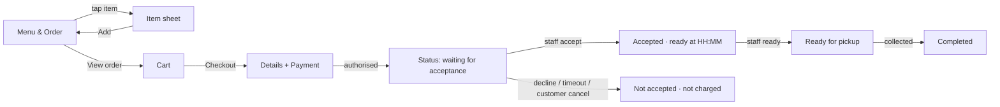

# Slice 1 — Pickup Ordering: Detailed Design

Status: **Confirmed by the project lead, 19 Oct 2026** (Phase 3 output; drafted 15 Oct 2026). Builds on ADR-0001…0007 (Confirmed).
Companion docs: [API.md](../API.md) (contract) · [DATABASE.md](../DATABASE.md) §6 (slice-1 schema) · [SECURITY.md](../SECURITY.md) §Slice 1 · [TESTING.md](../TESTING.md) §Slice 1 · [DEPLOYMENT.md](../DEPLOYMENT.md) §Environments.

## 1. Scope

**In the slice (end to end, all layers):**
1. Public site shell: Home (minimal), Menu & Order, Visit (hours/location), legal page placeholders.
2. Menu from the client's board (MENU.md), loaded by a seed migration. Item sheet with required/optional choices and extras.
3. Cart and server-priced totals. **Pickup only. ASAP only** (see assumptions).
4. Checkout: name, mobile, email, notes, terms acknowledgement, optional marketing opt-in → Stripe Payment Element (**authorise only**).
5. Order status page (token link) + transactional emails (received, accepted, declined, ready).
6. Staff area: sign-in with MFA, **live order board** (accept with ready time / decline with reason / ready / collected), sound alert, auto-decline on timeout.
7. Owner controls: **Open now until…**, **Close now**, weekly hours editor, date exceptions; sold-out toggles for items and options.
8. Manager: cancel an accepted order with a full or partial refund.
9. Background sweep (Cloudflare Cron Trigger, every minute; ADR-0012): acceptance timeouts, expired holds, outbox retries, Stripe reconciliation.

**Not in the slice:** delivery/Uber Direct (slice 2), later-today scheduling, full menu editor (price/description edits → slice 2; slice 1 changes prices via a reviewed seed/migration), customer accounts, promotions, POS adapter, SMS, Google reviews widget, About page content.

## 2. Deferred answers → working assumptions (each replaceable by data, not code)

| Open item | Working assumption for the build | Where it lives |
|---|---|---|
| F4 prep time | Default ready time = accept time + **10 min**. Staff can pick +5/+10/+15/+20/+30 | `fulfilment_settings.prep_minutes_default`, board UI |
| F5 nightly cut-off | Online ordering stops **30 min before** scheduled close | `fulfilment_settings.last_order_offset_minutes` |
| F6 later-today | **ASAP only** in slice 1. The slot model is reserved in the schema, not built | — |
| F7 acceptance limit | **5 min** to accept. Escalation alert at **3 min** | `fulfilment_settings.accept_timeout_seconds`, `accept_escalate_seconds` |
| F8 staff device | A counter tablet or phone running the board in a browser | Board UI |
| F11 combos & extras | Combos are products with **required choice groups whose options are data**. Seeded per the assumption in §4.3 and editable via seed until slice 2 | Seed data |
| Q6 legal entity / ABN | Footer and receipt read `{LEGAL_NAME}` / `{ABN}` from config. **Launch blocker**, not a build blocker | Env config |
| Q10 allergens | Allergen fields exist but are empty. Menu shows "Allergen info: ask staff". **Launch blocker** | `product.allergens` |
| Payment provider | Stripe (ADR-0004 default; no POS chosen) | `PaymentProvider` interface |
| Hours | Seeded from Google: Mon/Wed/Thu/Sun 11:00–22:00, Fri/Sat 11:00–01:00, Tue closed `[Assumption — Q15]` | Seed |

## 3. Customer journey & screens



Every async view designs five states: loading · empty · error · stale · success.

| Screen | Key content | States & edge cases |
|---|---|---|
| **Menu & Order** `/menu` | Live status chip ("Open · online orders until 9:30pm" / "Online ordering closed · opens Wed 11am" / "Paused by the shop"), category bar (scroll-spy), item rows (thumb, name, short description, price "from $4.49"), sold-out label, sticky cart bar | Closed: browsing allowed, "Add" disabled with the reason. Sold out: row greyed + "Sold out today". Status endpoint fails: show the cached menu, hide "Add", banner "Can't confirm we're open — try again". Image missing: text-only row (14 items) |
| **Item sheet** (bottom sheet on mobile, dialog on desktop) | Photo, name, description, allergen line, choice groups (radio for required single choice: Size Cutting/Regular; Style Raw/Grilled; checkboxes for extras with "+$2.00"), quantity stepper 1–20, live price preview, "Add · $x.xx" | Required group unanswered → Add disabled + "Choose a size". Option sold out → disabled option. Focus trapped, Esc closes, focus returns to the row |
| **Cart** (drawer/page) | Lines with choices, qty, line price, remove/edit. Server-priced subtotal, "includes GST $x", total | Server repricing differs → a message naming what changed + new total, user must confirm. Item became unavailable → named, "Remove" action. Empty cart → back to menu |
| **Checkout** `/checkout` | Summary (server-priced), "Pickup at Shop 6/189 William St · ready about 10 min after the shop accepts", name, mobile (AU format), email, order note (≤ 200 chars), terms + privacy acknowledgement, marketing opt-in (unticked), Payment Element (Apple Pay/Google Pay/card), "Place order · $x.xx" | Pay button disabled in flight. Idempotency key per attempt. Ordering closed mid-checkout → specific error, cart kept. Card declined → Element error, cart kept, same order retried. Hold expired (15 min) → "Your order timed out, please place it again" |
| **Status** `/order/[token]` | Order #, items, total, pickup address + map link, timeline, live message: "Sent to Chai Tapri — waiting for them to accept (usually within 5 minutes)". Your card is on hold, not charged | Polling every 5 s while not terminal, then stop. `aria-live="polite"` announcements. Declined → reason + "You have not been charged. The hold on your card is released (timing depends on your bank)". Refresh-safe |

## 4. Domain design

### 4.1 Modules (framework-free TypeScript in `src/domain`)
`menu` (catalogue read model, choice validation) · `pricing` (cart → priced breakdown, integer cents) · `availability` (store status at instant *t*) · `orders` (state machine, transitions) · `payments` (`PaymentProvider` interface + Stripe adapter) · `notifications` (email templates via outbox) · `staff` (roles, capabilities) · `clock` (injectable, `Australia/Perth`).

### 4.2 Availability algorithm (pure function, unit-tested)
```
status(t):
  if killSwitch → CLOSED(reason: "unavailable")
  ov = latest active override at t (scope all)
  if ov.mode = closed → CLOSED(reason: "paused", until: ov.endsAt)
  if ov.mode = open   → OPEN(until: ov.endsAt)            -- owner "Open now until"
  day = tradingDay(t)    -- 00:00–04:59 belongs to the previous calendar day (covers the 1am close)
  windows = dateException(day) ?? weeklyHours(day.weekday)
  for w in windows (ordering windows = shop window minus last_order_offset at the end):
     if w.open ≤ t < w.close − offset → OPEN(until: w.close − offset)
  → CLOSED(reason: "outside_hours", nextOpen: nextWindowStart(t))
canOrderNow(t) = status(t).open AND (until − t) ≥ prep_minutes_default
```
- Trading-day boundary 05:00 local `[Assumption]`: safe because the latest close is 01:00.
- `nextOpen` searches up to 14 days of hours + exceptions.
- The same function powers the status chip, `POST /orders` validation and the board header. They can't disagree (BR-AV-12).

### 4.3 Menu model for the board items
- **Chai** (Masala, Ginger, Cardamom, Pudina): one product each, required group *Size* {Cutting $4.49 base, Regular +$1.00}. **Bournvita**: Regular only, $5.49.
- **Cheese Chutney / Veg Sandwich**: required *Style* {Raw $7.90 base, Grilled +$2.00}.
- **Extras** groups (0–2 each `[Assumption]`): Cheese +$2.00, Chutney +$1.50, attached per board (puffs, vada pav, sandwiches, street specials). Samosa: Chutney only.
- **Combos** `[Assumption — F11]`: *Cutting Chai + Bun Maska* $9.49 → required *Chai* {Masala, Ginger, Cardamom, Pudina}, Bun Maska = Classic. *Cutting Chai + Samosa* $8.49 → required *Chai*, Single Samosa. *Grilled Sandwich + Drink* $15.99 → required *Sandwich* {Cheese Chutney (grilled), Veg (grilled)} + required *Drink* {Pepsi Max, Coca Cola, Solo, Sunkist, Water}. Options are seed data, changeable without code.

### 4.4 Pricing rules
`line = (product.base_price + Σ option.price_delta) × qty`. `subtotal = Σ lines`. `total = subtotal` (pickup: no fees, no surcharge). `gst = round_half_up(total / 11)` for display. Limits: qty 1–20 per line, ≤ 30 lines, total ≤ A$500 `[Assumption]` (anti-abuse; above that → "please call the shop").

### 4.5 Order state machine (authoritative for slice 1)

| From | To | Trigger (actor) | Preconditions | Side effects (outbox unless noted) |
|---|---|---|---|---|
| — | `pending_payment` | `POST /orders` (customer) | store open; items/options available; repriced; within limits | create PaymentIntent (`capture_method=manual`, idempotency key = order id); hold expires in 15 min |
| `pending_payment` | `awaiting_acceptance` | Stripe `payment_intent.amount_capturable_updated` (system) | PI `requires_capture`, amount = order total | `accept_deadline_at = now + 5 min`; board alert; email *received* |
| `pending_payment` | `expired` | sweep (system) | hold expired, no authorisation | cancel PI if it exists |
| `awaiting_acceptance` | `accepted` | staff Accept | status still `awaiting_acceptance` (conditional update); before deadline | set `promised_ready_at`; job `payment.capture`; email *accepted* |
| `awaiting_acceptance` | `declined` | staff Decline (reason) | conditional update | job `payment.cancel`; email *declined* |
| `awaiting_acceptance` | `timed_out` | sweep (system) | `now ≥ accept_deadline_at` | job `payment.cancel`; email *declined (timeout)*; owner alert |
| `awaiting_acceptance` | `cancelled` | customer Cancel (token) | conditional update | job `payment.cancel`; email *cancelled* |
| `accepted` | `ready` | staff Ready | payment `captured` | email *ready* |
| `ready` | `completed` | staff Collected, or sweep after 60 min (`not_collected=true`) | — | — |
| `accepted`/`ready` | `cancelled` | manager Cancel + refund choice | reason required | job `payment.refund` (full or partial); email *cancelled* |

Rules: transitions run in one function with `UPDATE … WHERE id=$1 AND status=$2` and check the row count. Zero → `409 conflict` with fresh state ("Already accepted by another staff member"). Every transition is appended to `order_event`. Terminal: `completed`, `declined`, `timed_out`, `cancelled`, `expired`.

**Capture failure** (rare: authorisation revoked) → order `accepted` with `payment_status=capture_failed` → board shows a red banner "Payment failed — don't prepare", staff call or decline. Never silently prepare unpaid food.

### 4.6 Payment status (separate field)
`none → authorising → authorised → captured → partially_refunded | refunded`; `authorised → cancelled`; `authorising → failed`; `authorised → capture_failed` as above. Changes only from Stripe API responses or verified webhooks: `payment_intent.amount_capturable_updated`, `payment_intent.succeeded` (after capture), `payment_intent.canceled`, `payment_intent.payment_failed`, `charge.refunded` / `refund.updated`.

### 4.7 Checkout sequencing
**Order first, then payment** (reliability reference option A): the order row exists before any money moves, the kitchen sees it only after authorisation, and expired attempts are swept. Stripe online card holds are valid 7 days `[Verified — Stripe docs]`; we capture within ~5 min.

## 5. Staff screens

| Screen | Content | Behaviour |
|---|---|---|
| **Sign-in** | Email + password → TOTP (manager/owner mandatory, staff optional `[Assumption]`) | Rate-limited. Generic error text. 12 h session |
| **Order board** `/admin/board` | Header: store status + **Close now** (all staff) + **Open now / Keep open until…** (owner). Columns: *New* (countdown ring to auto-decline) · *Accepted* (ready time) · *Ready* | **"Start shift" button** unlocks audio (browsers block autoplay sound) and requests a screen wake-lock. Polls every 5 s. Shows "Connection lost" if 2 polls fail. New order: chime every 10 s until handled. 3 min: louder alert + owner email/SMS-later. Accept sheet: ready-time chips (+5/+10/+15/+20/+30). Decline sheet: reasons (too busy / item unavailable / closing soon / other). Conflicts show the fresh state |
| **Order detail** | Items/choices, notes, customer first name + masked phone (tap to reveal, audited), timeline, payment status | Manager: Cancel & refund (full / select lines) |
| **Availability** `/admin/menu` | Category list with toggles per item and option; "Sold out until tomorrow" default | Optimistic toggle with rollback on error |
| **Hours** `/admin/hours` (owner) | Weekly table (multiple windows, crosses midnight), last-order offset, exceptions list (date, closed/special hours, reason) | Validation: open < close, or "closes next day". Warns about orders waiting/in progress today |

Accessibility: board keyboard-operable (A = accept, D = decline on the focused card), a visual flash plus sound (never sound only), large targets, high contrast.

## 6. Notifications (email, transactional only)
*Received* (on hold, not charged; waiting for acceptance) · *Accepted* (ready at HH:MM; tax invoice: legal name, ABN, "Tax invoice", GST amount) · *Declined/Timed out/Cancelled* (reason, not charged / refund amount and timing) · *Ready*. Sent via outbox. A failed email never blocks the order.

## 7. Failure matrix (slice 1) → expected behaviour (each becomes a test)

| Scenario | Expected |
|---|---|
| Double-click Place order / network retry | Same idempotency key → same order + same PaymentIntent. One hold |
| Price/availability changed since cart | `409 cart_changed` listing changes. Nothing created |
| Ordering closes during checkout | `409 ordering_closed` before the PI. If already authorised within the hold → still goes to the board (BR-AV-9) |
| Authorisation webhook late | Status page shows "Confirming payment…". The reconciliation sweep pulls the PI after 2 min |
| Webhook duplicated / out of order | `webhook_event` unique. A transition that isn't forward-valid is ignored + logged |
| Authorisation arrives after the hold expired (slow 3-D Secure, race with the sweep) | The sweep cancels the PaymentIntent when it expires an order, so a late confirmation normally fails at Stripe. If an `amount_capturable_updated` still arrives for an `expired` order → no transition, queue `payment.cancel`, email "Your order timed out, you have not been charged" |
| Two staff tap Accept | One wins. The other gets 409 + fresh state |
| Nobody accepts | Auto-decline at 5 min, hold cancelled, customer emailed, owner alerted |
| Capture fails after accept | Red banner. Staff decide. No food prepared unpaid |
| Customer opens another order's status page | Only a valid 128-bit token works. Unknown token → 404 (no existence leak) |
| Stripe down at checkout | `503 payment_unavailable`, cart kept, alert fires |
| Sweep not running (cron failure) | Lazy checks: `/orders/{token}` and the board treat past-deadline orders as timed out and trigger the transition. Uptime alert on sweep heartbeat |
| Refund requested twice | Idempotency key per refund request. One refund |

## 8. Slice acceptance criteria
1. A customer on a 390 px phone can order Masala Chai (Regular) + Classic Vada Pav with extra cheese, pay with a Stripe test card / Apple Pay test, and see "waiting for acceptance" within 5 s of authorisation.
2. Staff accept on the board → the customer's page shows "Accepted · ready at HH:MM" within 10 s, the PI is captured, and the email is sent.
3. Decline and timeout both cancel the PI (Stripe shows `canceled`) and nothing is captured.
4. With ordering closed (schedule, override, or exception), `POST /orders` is rejected and the menu shows the correct reason and next opening.
5. Fri 23:50 / Sat 00:40 / Tue cases from BUSINESS_RULES §1.4 pass as unit tests.
6. Tampered price/qty/option IDs are rejected (tests).
7. Duplicate and concurrent requests prove one order, one hold, one capture.
8. Lighthouse mobile ≥ 90 on `/menu`. axe shows no serious violations on menu, item sheet, checkout, status, board. Keyboard-only order completes.
9. Manager refund works (full and partial) and appears in the audit log.

## 9. Open items to resolve during build (non-blocking)
Board hardware (F8) · email sender domain (needs the domain, Q21) · exact copy for decline reasons and emails · sold-out reset time (proposed 05:00 trading-day boundary).
