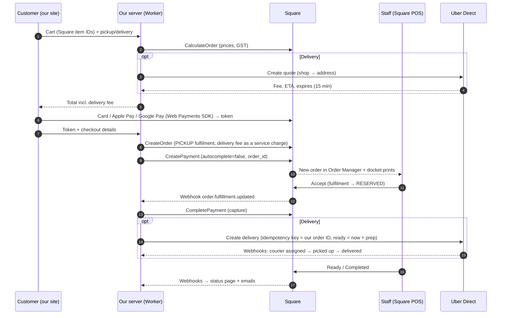

# Square POS + Uber Direct: Integration Plan

Status: **Proposed, 31 Oct 2026. Needs the owner's approval** (POS path, payment provider and money flow are approval gates). Nothing here is built until ADR-0014 and ADR-0015 are `Confirmed`.
Builds on: [INTEGRATIONS.md](../INTEGRATIONS.md) §2–4 (research of 14 Oct) · ADR-0003, ADR-0004, ADR-0005 · [SLICE-01-pickup-ordering.md](SLICE-01-pickup-ordering.md).
Facts checked 31 Oct 2026 against Square and Uber developer docs and the Square developer forum. Labels as in CLAUDE.md.

## 1. The question

The project lead asked (31 Oct 2026) to use **Square POS APIs for ordering, maybe the catalogue and open/closed status**, plus **Uber Direct for delivery**, letting the APIs do as much as possible instead of building it ourselves. Customers order on our website for **pickup** (Square) or **delivery** (Uber Direct courier).

## 2. Short answer

Square can take over most of the back office we planned to build:

| Job | Today's plan (slice 1) | With Square | Evidence |
|---|---|---|---|
| Menu, prices, choices, extras | Seed file in our code, admin edits later | **Square catalogue** (items, variations, modifier lists). The owner edits prices in the Square Dashboard. The website reads them and keeps only photos and presentation, keyed by Square item ID | `[Verified]` Catalog API |
| Sold-out | Our admin toggles | **Square** "sold out" per item variation, set in the POS. A `catalog.version.updated` webhook tells us. Apps can read it but not write it | `[Verified]` Square sold-out guide |
| Prices and totals (GST incl.) | Our pricing code | **Square calculates** the order total from catalogue IDs. Our server sends only IDs and quantities and charges the total Square returns | `[Verified]` Orders API (CalculateOrder / CreateOrder) |
| Card payments, Apple Pay, Google Pay | Stripe (ADR-0004 default) | **Square Web Payments SDK** + Payments API. Card details never touch our servers | `[Verified]` Web Payments SDK |
| Authorise now, charge on accept | Stripe manual capture | **Square delayed capture**: `autocomplete=false`, held up to **7 days** online, then `CompletePayment` or `CancelPayment` | `[Verified]` delayed-capture guide |
| Staff order board (accept, ready, collected, sound alert) | Custom-built screen | **Square POS Order Manager** on the counter device, plus the kitchen printer (KDS needs Square for Restaurants Plus) | `[Verified]` orders with a fulfilment appear in POS once paid · KDS plan per INTEGRATIONS §2.3 |
| Order status for the customer | Our board drives it | **Square webhooks** (`order.fulfillment.updated`) drive our status page and emails | `[Verified]` Orders webhooks |
| Refunds | Our admin → Stripe | **Square POS / Dashboard** refunds. A `refund.updated` webhook updates our order | `[Verified]` Refunds API |
| Sales reporting | Split between till and Stripe | **One place**: web orders sit in Square next to walk-in sales | `[Inference]` |
| Opening hours and "close now" | Our hours editor + ordering controls (built, PR #3) | **Keep ours.** Square stores weekly hours (Locations API) but has no API for "pause online ordering" or "open until 11:30 tonight", and online ordering hours differ from store hours (last order 30 min before close) | `[Verified]` Locations API fields · `[Inference]` no pause API found |
| Delivery courier | Uber Direct (ADR-0005) | **Still Uber Direct, called by our server.** Square's own delivery fulfilment is closed to us (see §3.1) | `[Verified]` |

**What we still build:** the customer website (menu, cart, checkout, status page), our `orders` record (link between the Square order, the payment and the Uber delivery), the webhook receivers, the 5-minute acceptance timeout, Uber Direct quotes and deliveries, the owner's ordering controls, and emails.

**What we no longer build:** the staff order board, its sound alert and live updates, the menu and price editor, sold-out toggles, refund screens, and Stripe. That is roughly a third of slice 1 `[Inference]`, and staff learn one system instead of two.

## 3. Catches found in the research

### 3.1 Square's DELIVERY order type is partners-only
- Square's docs mark the `DELIVERY` fulfilment as closed beta: only approved Square partners can use it, and "orders aren't shown in Square Point of Sale unless you have a formal partnership agreement" `[Verified, Square fulfilments docs]`.
- Square staff confirmed this to a single-restaurant developer in Australia (10–15 Sep 2026). The API returns 200, but the order never shows in Order Manager, POS or KDS. Their advice was not to design around getting beta access `[Verified, Square developer forum]`.
- **Plan:** send delivery orders to Square as a **`PICKUP` fulfilment collected by the Uber courier**. For the kitchen the work is the same: make it by a time and hand it over at the counter. The recipient name reads e.g. "UBER COURIER · Priya", and the docket note says "Delivery: Uber Direct". `[Inference]` This must be proven in the sandbox (spike S0).
- **Fallback:** a `SHIPMENT` fulfilment, which Square staff suggested for local delivery and which prints per the location's printer settings `[Verified, forum]`. Its statuses differ from pickup, so staff would see two flows.

### 3.2 Does an authorised-but-not-charged order show in Order Manager?
- Square says API orders appear in POS **once paid**. Its docs say an order can be paid with a delayed-capture (approved) payment `[Verified]`.
- Whether Order Manager shows it **before** we capture: `[Unknown]`. No doc confirms it either way, so this is the first thing spike S0 tests.

| Spike result | Flow |
|---|---|
| **A. Visible while only authorised** (hoped for) | Customer pays → card **authorised** → order appears in Order Manager → staff tap Accept → webhook → we **capture**. Decline or 5-minute timeout → we **void**. Nobody is charged for a declined order (BR-PAY-2 kept) |
| **B. Visible only after capture** | Card **charged at checkout** → staff decline → we **refund**. Changes BR-PAY-2 and money flow, so **owner approval needed**. Square's fee on refunded payments in AU: `[Unknown — check with Square]` |

### 3.3 Hours stay on our side
Square's Locations API has weekly `business_hours`. The search found no special (holiday) hours and no "pause online ordering" in the API `[Inference — absence of evidence]`, and the `location.updated` webhook is Beta `[Verified]`. Our availability engine and owner controls are already built and tested, so they stay the source of truth for **online ordering**. Optional later: import Square's weekly hours as the starting point so the owner types them once.

### 3.4 Square Online is the "do nothing" alternative
Square's hosted Square Online ordering site already connects to Uber Direct `[Verified, Uber's Square partner page; US-centric, AU availability unconfirmed]`. It would replace our checkout entirely but lose the custom site the client asked for (tapri wall design, photos, franchise and merch pages, our ordering rules). **Not recommended**, but listed so the owner knows it exists.

## 4. How an order flows

**Decline or timeout:**
- Staff cancel the order in Order Manager, or our minute-sweep finds it unaccepted after 5 min (F7 assumption).
- We call `CancelPayment` (void), set the Square order to CANCELED, and email the customer. No Uber delivery has been created yet, so there's nothing to cancel there.

**Delivery fee in Square:** added as a **service charge** line "Delivery (Uber Direct)" on the Square order. The customer total in Square then equals what was charged, and the weekly reconciliation (INTEGRATIONS §4.4 step 7) compares it with Uber's invoice `[Recommendation]`.

## 5. Rules that stay on our server

- **Square is the price authority.** Our server never accepts a price from the browser. It sends catalogue IDs, and the amount charged is Square's computed total plus the server-held Uber quote. A tampered cart can only change *which* items are ordered.
- Ordering open/closed, cut-off, max items and the delivery minimum order/maximum distance (F2) are checked **on the server** before the Square order is created.
- An order counts as paid only on a **verified Square webhook**. The `x-square-hmacsha256-signature` header is a base64 HMAC-SHA256 over the notification URL + raw body, checked with the official SDK helper. Uber webhooks: `x-uber-signature`, HMAC-SHA256 over the raw body `[Verified]`.
- **Idempotency:**
  - Square `CreateOrder` and `CreatePayment` take idempotency keys = our order ID + attempt `[Verified]`.
  - Uber `idempotency_key` = our order ID; Uber keeps it for 6 h `[Third-party — confirm in Uber's API reference]`.
- **Safety-net polling:**
  - Uber retries webhooks only on 5xx/timeouts, 3 times `[Verified]`, so the sweep polls active deliveries.
  - The sweep also re-reads Square orders stuck in "awaiting acceptance".
- **Customer data:**
  - Name, phone and email go to Square (on the pickup fulfilment) and Uber (dropoff contact), because they need them to do the job.
  - We don't create Square Customer profiles. Customer data stays out of logs.
  - The sandbox uses fake details only.

## 6. What the owner needs to set up (no passwords or keys in chat or email)

1. **Square account** on the shop's ABN (Q6). POS plan: Free works for Order Manager + printer `[Inference — confirm]`; a KDS screen needs Square for Restaurants Plus `[Verified, 14 Oct]`.
2. **Square Developer app** (developer.squareup.com), created by the owner or with the developer added to the account team.
   - Sandbox credentials first.
   - Production access token with the minimum permissions: ITEMS_READ, ORDERS_READ/WRITE, PAYMENTS_READ/WRITE, INVENTORY_READ, MERCHANT_PROFILE_READ.
   - Stored as Wrangler secrets.
3. **Enter the menu in Square**, item by item, with sizes (Cutting/Regular, Raw/Grilled) as variations and extras as modifier lists. We can script this from `src/domain/menu.ts` with the Catalog API, so the owner only reviews it `[Recommendation]`.
4. **Uber Direct Developer tab** (F3): Customer ID, Client ID/Secret and a webhook signing key, test mode first.

## 7. Build plan (after approval)

| Step | What | Done when |
|---|---|---|
| **S0 Spike** (1–2 days, sandbox) | Create orders + delayed-capture payments in the Square sandbox. Check what Order Manager shows (§3.1, §3.2). Uber test quote + Robocourier delivery | Written answers to §3.1 and §3.2, with screenshots. Plan adjusted if result B |
| **S1 Catalogue** | Script to load our menu into Square (sandbox, then the owner's account). Catalogue sync (webhook + "sync now" + 15-min fallback) into a read cache. Menu page reads it, photos keyed by Square ID, sold-out shown | Menu prices and sold-out come from Square. Square down → last good copy shown |
| **S2 Pickup checkout** | Web Payments SDK (CSP updated for Square's script/frame origins), CreateOrder + CreatePayment, webhooks, acceptance timeout, status page, emails | Pickup order placed on staging → appears in Order Manager → accept → captured → ready → status page follows |
| **S3 Delivery** | Address + quote at checkout, minimum order/maximum distance, service charge, Uber delivery on accept, Uber webhooks + polling, failure handling (INTEGRATIONS §4.4 step 6) | Robocourier delivery runs end to end on staging |

Each step meets the definition of done: server rules, tests for happy/edge/failure paths in CI, accessibility, docs. Stripe work is dropped. The existing `PaymentProvider` / `PosAdapter` seams get a Square implementation, with the database changes made in a reviewed migration at S1.

## 8. Decisions needed from the owner

| # | Decision | Recommendation |
|---|---|---|
| D1 | **Square is the shop's POS and the website's payment provider** (answers Q1; replaces the Stripe default in ADR-0004) | Yes. One system for menu, orders, payments and reports. 2.2% online `[Verified, Square AU help]` |
| D2 | **Staff handle web orders in Square POS Order Manager**, not a custom board (supersedes ADR-0003's P3) | Yes, subject to spike S0 |
| D3 | **Menu and prices are edited in Square**, and the website follows | Yes |
| D4 | If spike S0 gives result B: **charge at checkout, refund on decline** | Decide after S0 |
| D5 | **Delivery fee drift:** the quote is fixed at checkout, but the delivery is booked at acceptance and Uber's fee may differ | Shop absorbs up to A$2. Above that, staff call the customer or cancel with a full refund (F17) |
| D6 | **Undeliverable food:** return to the shop (Uber's default, charges a 50% return fee) or leave at door | Leave at door for food, matching the drop-off note at checkout (F17) |

## 9. Sources (checked 31 Oct 2026)
- Square: Orders API fulfilments, Create orders, Delayed capture, Web Payments SDK overview, Monitor sold-out status, Locations API, `location.updated` webhook (developer.squareup.com/docs and /reference).
- Square developer forum: "Australian restaurant app: DELIVERY partner access and Square/Nash delivery data" (Sep 2026).
- Square AU help: fees and payments FAQ (2.2% online).
- Uber Direct: Authentication (token 30 days, `eats.deliveries`, 100 token requests/hour), Webhooks (signature, retries), Robocourier (developer.uber.com/docs/deliveries); Uber × Square partner page (merchants.uber.com).
